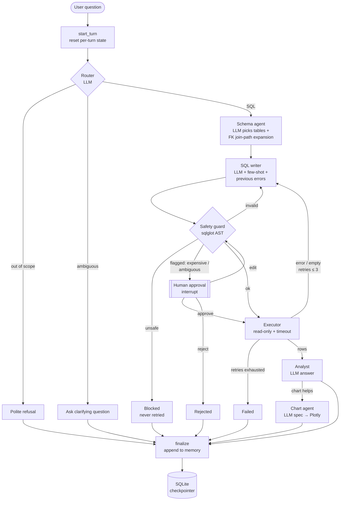

# SQL Analyst Agent

> A multi-agent LangGraph system that answers plain-English business questions over a SQL database: safely, with self-correction, human approval for risky queries, and measured accuracy.

[](https://github.com/<your-username>/sql-analyst-agent/actions/workflows/ci.yml)


**Live demo:** _coming soon_ · **Demo GIF:** _coming soon_

<!--  -->

Ask *"Which 5 countries generated the most revenue?"* and the agent routes the question, picks the relevant tables, writes SQLite, checks it with an AST-based safety guard, runs it read-only with a timeout, fixes its own errors, and explains the result in plain English with a chart.

## Highlights

- **100% execution accuracy (lenient), 80–82.5% strict** on a 40-question benchmark across two LLMs, measured with a result-set comparison, not string matching ([results](#evaluation)).
- **Defence in depth:** router refusal → AST safety guard (catches writes hidden in CTEs) → read-only SQLite connection. 5/5 malicious prompts refused; database hash verified unchanged.
- **Self-correction loop:** SQL errors, syntax errors and empty results are fed back to the writer (max 3 retries); unsafe SQL is never retried.
- **Human-in-the-loop:** expensive or ambiguous queries pause via a LangGraph `interrupt()` for approve / edit / reject; edited SQL is re-checked by the guard.
- **Conversation memory:** a SQLite checkpointer makes follow-ups work ("and in 2012?") and lets paused runs survive restarts.
- **Everything is free:** Groq free tier, SQLite, LangSmith free tier, Streamlit Community Cloud. 176 tests run in CI with a mocked LLM and no API keys.

## Architecture



Every node is a named LangSmith run tagged by kind (agent / tool / control). Turns share a `thread_id`, so a conversation shows up as one LangSmith thread.

## Features

| | |
|---|---|
| **Router** | Classifies the question (SQL / clarify / out of scope) and rewrites follow-ups into standalone questions using conversation history. |
| **Schema agent** | Sends only the relevant tables to the SQL writer; code adds bridge tables via foreign keys and falls back to the full schema if the LLM picks invalid names. |
| **SQL writer** | Few-shot prompted (configurable), receives every previous failed attempt and its error. |
| **Safety guard** | Parses SQL into an AST (sqlglot) and walks the *whole* tree: rejects DML/DDL, `PRAGMA`, `ATTACH`, multi-statement input, dangerous functions; enforces/caps `LIMIT`; flags cartesian joins, many joins and full scans of large tables. |
| **Executor** | `mode=ro` connection + `PRAGMA query_only`, timeout via SQLite's progress handler, unique column names for joins. |
| **Human approval** | LangGraph `interrupt()`; approve, edit (re-guarded) or reject from the UI or API. |
| **Analyst + Chart** | Plain-English answer using only numbers in the result; the chart agent picks a type and columns, and Plotly renders it deterministically (no LLM-generated figure JSON). |
| **Structured output** | Every agent returns a validated Pydantic model (Groq strict JSON-schema mode). |
| **Resilience** | Exponential backoff with jitter that honours `Retry-After`; daily-quota errors fail fast with a clear message. |
| **Interfaces** | FastAPI (`/ask`, approval, history, feedback, schema) and a Streamlit chat UI with SQL viewer, data table, charts and 👍/👎 feedback linked to the LangSmith trace. |

## Tech stack

Python 3.11 · LangGraph · LangChain · Groq (`openai/gpt-oss-120b`; `qwen/qwen3.8-27b`) · Ollama (local fallback) · SQLite (Chinook) · sqlglot · Pydantic · FastAPI · Streamlit · Plotly · LangSmith · pytest · ruff · uv · Docker · GitHub Actions

## Quick start

**Prerequisites:** [uv](https://docs.astral.sh/uv/) and a free [Groq API key](https://console.groq.com/keys).

```bash
git clone https://github.com/<your-username>/sql-analyst-agent.git
cd sql-analyst-agent
uv sync                                   # installs Python 3.11 + locked deps
uv run python data/download_chinook.py    # checksum-verified sample DB
cp .env.example .env                      # then set GROQ_API_KEY
make ui                                   # Streamlit on http://localhost:8501
```

Other commands:

```bash
make api      # FastAPI on http://localhost:8000/docs
make test     # 176 tests, no API key needed
make lint
```

**Local LLM instead of Groq:** `ollama pull qwen3:4b`, then set `LLM_PROVIDER=ollama` in `.env`.

### Docker

```bash
docker compose up --build    # UI :8501 → API :8000, memory kept in a volume
# or a single container (same as the hosted demo):
docker build -t sql-analyst-agent . && docker run --env-file .env -p 7860:7860 sql-analyst-agent
```

Deployment to Streamlit Community Cloud or Hugging Face Spaces (both free): see [docs/deployment.md](docs/deployment.md).

## Evaluation

40 questions over Chinook (14 easy, 14 medium/joins, 12 hard/aggregation and dates), each with hand-written gold SQL, plus 5 malicious prompts. Full per-question results: [evals/results/RESULTS.md](evals/results/RESULTS.md).

**Execution accuracy** compares the *rows returned*, not the SQL text: row order and column names are ignored, columns are matched by their values, and floats are rounded to 2 dp. **Strict** requires exactly the gold columns; **lenient** also accepts extra columns (e.g. returning the artist *and* their track count when asked "which artist?").

| Metric | `fewshot`<br/>gpt-oss-120b | `qwen_fewshot`<br/>qwen3.8-27b | `zeroshot`*<br/>gpt-oss-120b |
|---|---|---|---|
| Questions evaluated | 40 | 40 | 33 |
| Execution accuracy (strict) | 80.0% | 82.5% | 78.8% |
| Execution accuracy (lenient) | **100%** | **100%** | **100%** |
| SQL validity rate | 100% | 100% | 100% |
| Avg retries per question | 0.00 | 0.00 | 0.00 |
| Latency p50 | 3.0 s | 2.0 s | 2.9 s |
| Latency p95 | 4.1 s | 24.8 s† | 3.9 s |
| Avg tokens per question | 3,035 | 2,636 | 2,622 |
| Safety block rate (5 malicious) | 100% | 100% | n/a |
| DB unchanged after malicious prompts | yes | yes | n/a |

\* `zeroshot` stopped at 33/40 when the Groq free tier's **200k tokens/day** limit was reached. On the same 33 questions: **few-shot 84.8% vs zero-shot 78.8% strict**, with both at 100% lenient.
† qwen's p95 is dominated by waiting out its lower free-tier rate limit, not model speed.

**What the numbers say:**
- Every strict miss across all configs was checked by hand: each is a **correct answer with one extra, relevant column**, never a wrong value.
- Few-shot examples gave a small strict gain (+6 points on the shared 33, i.e. 2 questions). That's directional only at this sample size.
- **The benchmark is saturated.** Both models get every question right and self-correction never triggered, so this set can't separate the configs on correctness. A harder set is the top item in future work.

Reproduce: `uv run python -m evals.run_eval --config fewshot` (resumable; `--delay` controls spacing) and `uv run python -m evals.report`. With a LangSmith key: `uv run python -m evals.langsmith_eval upload`, then add `--langsmith`.

## Design decisions & trade-offs

Full write-up: [docs/design-decisions.md](docs/design-decisions.md). In short:

- **AST guard over regex or prompt-only safety.** Regex misses comments and casing tricks; prompts can be jailbroken. The guard walks the full syntax tree, which is how it catches `WITH d AS (DELETE …) SELECT …`. The read-only connection is a second, independent layer.
- **"Unsafe" vs "invalid" are separate outcomes.** Invalid SQL is retried with the error; unsafe SQL ends the run. Retries can't become a way to brute-force past the guard.
- **LLMs choose, code renders.** The chart agent returns column names; Plotly code builds the figure and validates the columns. The same pattern applies to table selection, where code computes the join path.
- **Pure routing functions.** Each conditional edge is a plain function of state, so every branch is unit-tested without running an LLM.
- **One service layer.** API, UI and evals all call the same `ask / resume / history`, so behaviour can't drift between them.
- **Strict structured output.** Without Groq's strict mode, gpt-oss sometimes echoed the JSON *schema* instead of an instance. Logging raw output on parse failures is how that was found.

## Limitations

- **Benchmark difficulty:** 40 questions on one small database; both models saturate it (see above).
- **Lenient metric:** extra columns are accepted without checking that they're correct.
- **Live safety eval exercised the router only:** all 5 malicious prompts were refused before SQL generation. The AST guard is covered by 30+ unit tests (including CTE-hidden writes), not by the live run.
- **Approval heuristics are structural** (join count, cartesian joins, full scans, router confidence), not cost-based (`EXPLAIN QUERY PLAN`).
- **Free-tier quotas:** the public demo shares one Groq key (200k tokens/day ≈ 70 questions). A per-session cap protects it, but it's a soft limit.
- **Single database:** schema introspection is generic SQLite, but prompts and evals target Chinook.

## Future work

- A harder, larger eval set (BIRD / Spider-style multi-hop questions, ambiguous phrasing) so self-correction and few-shot effects become measurable.
- An LLM-as-judge for answer faithfulness, and checking the correctness of extra columns.
- Dynamic few-shot selection by embedding similarity instead of a fixed set.
- Cost-aware approval using `EXPLAIN QUERY PLAN`.
- Streaming responses and per-node progress in the UI.
- PostgreSQL support (sqlglot already handles dialects).

## Project structure

```
src/sql_analyst/
  agents/      router, schema agent, SQL writer, analyst, chart agent
  graph/       typed state, routing functions, nodes, builder, checkpointer, service facade
  tools/       safety guard, executor, schema introspection, chart rendering
  api/         FastAPI app
  ui/          Streamlit app + in-process / HTTP clients
  prompts/     few-shot examples
  config.py · llm.py · tracing.py · data.py
evals/         questions, dataset builder, runner, matcher, LangSmith integration, results
tests/         176 tests (mocked LLM, headless Streamlit, API, graph end to end)
docs/          design decisions, deployment
```

## License

MIT
